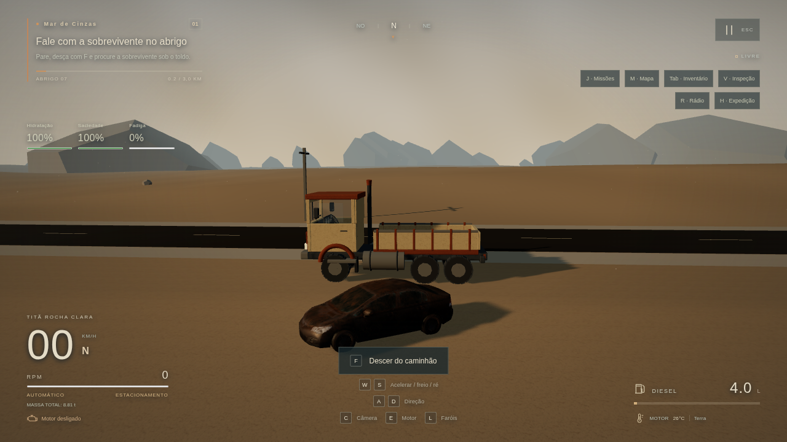

# Integração parcial de assets — 0.5.1

29/10/2026 · projeto existente preservado · Fase 2 da reformulação **em andamento**.

## 1. Melhorias realizadas

- Três modelos reais de carros abandonados de Renafox convertidos para GLB, com UVs e materiais PBR próprios, texturas até 1K e escala em metros. Quatro posicionamentos escolhidos perto da rodovia, oficina e acesso ao Núcleo, com colisores orientados e streaming por proximidade.
- Terreno refinado junto à rede de estradas: amostras longitudinais de 8 m e faixas de aproximadamente 2 m nas rotas. Resolve a interpolação do terreno grosseiro sobre o asfalto. Mesma malha para visual e Rapier; setores 3×3 preservados.
- Segmentos de estrada reutilizáveis, UVs em metros e acostamentos com geometria/colisão e aderência de cascalho. Materiais do abrigo/oficina/cabine separados por função, preparados para receber mapas corretos.
- AssetManager local com cache, clones de esqueleto, referências e liberação de texturas, geometrias e esqueletos. Loader glTF/GLB e Meshopt oficial; ausência de um modelo não inutiliza o jogo.
- Downloader oficial revisado e importer offline, validação de imagens/checksums/cache, preparação de resoluções por perfil e manifesto que só publica materiais completos.
- PBRLibrary com sRGB/dados lineares, normal GL, ARM correto, UVs/escala física e troca de resolução por perfil. Mistura de solo/rocha/cascalho/rachaduras preparada por inclinação, altura e distância das estradas.
- Adaptadores separados para exterior/rodas do caminhão e animação de personagens. Testados com fixtures originais; **os caminhões/NPCs escolhidos não foram integrados**.
- IBL do céu procedural no Alto, mantida fora de Baixo/Médio após medir seu custo em renderização por software. Não se trata de HDRI baixado.

## 2. Arquivos modificados

| Grupo | Arquivos principais |
| --- | --- |
| Preparação | scripts/baixar-polyhaven.mjs, importar-polyhaven.mjs, inspecionar-glb.mjs, lib/polyhaven.mjs, lib/prepare-textures.mjs, prepare-cars.py, BAIXAR_TEXTURAS.bat |
| Catálogo/origens | materiais_2047.json, docs/CATALOGO_ASSETS.json, docs/asset-kit, docs/PEDIDO_ASSETS_2026-10-29.md |
| Recursos/renderização | src/game/assets/AssetManager.js, render/PBRLibrary.js, TerrainBlend.js, metricUV.js, materials.js, SceneRenderer.js |
| Mundo | world/EnvironmentModels.js, terrainGeometry.js, roadGeometry.js, World.js, CampaignWorld.js, ExpeditionWorld.js, terrain.js |
| Modelos/integração | vehicle/TruckVisual.js, model.js, player/CharacterActor.js, core/Game.js |
| Assets/registro | public/assets/models/manifest.json, environments/renafox-cars/*.glb e LICENSE.txt; polyhaven/manifest.json e instalacao.json |
| Testes | unit/asset-pipeline.test.js, road-geometry.test.js, e2e/assets.spec.js, helpers/asset-fixtures.mjs |
| Continuidade | README, STATUS, AGENTS, DECISOES, CHECKLIST_MANUAL, ASSETS_PENDENTES, COMO_ATUALIZAR, docs/INTEGRACAO_ASSETS.md |

Sharp 0.35.5 foi declarado explicitamente como dependência de preparação, na versão já trazida pelo Next. Não foi substituída a stack e não foi escrito código TypeScript. O build usa a verificação interna do Next.

## 3. Assets efetivamente instalados

| Asset | Origem | Formato | Estado | Uso |
| --- | --- | --- | --- | --- |
| Três carros abandonados | Renafox, pacote fornecido pelo usuário | GLB com PBR original até 1K | Integrados; 1.516 / 1.382 / 1.466 triângulos | Cenário com colisões e streaming |
| Poly Haven — 24 IDs | Catálogo do usuário/kit | PNG/JPEG esperados | **0 instalados** | API bloqueada; ZIPs 4K acima do limite |
| GAZ-52 selecionado | Sketchfab / Renafox | Não recebido | Não integrado | Termos/direitos e arquivo pendentes |
| LP 608 | Sketchfab / Max | ZIP recebido acima de 32 MiB | Não foi possível abrir | Modelo/rig/física pendentes |
| Peterbilt 359 | Sketchfab | Não recebido | Não integrado | Licença/arquivo e remoção das toras pendentes |
| Saia LTL Freight | Ehsan Abbasi; ZIP fornecido | glTF/BIN/imagens | Inspecionado, não integrado | CC BY-ND e 1.970.772 triângulos |
| City People | Denys Almaral; ZIP fornecido | 11 glTF rigados + BIN/PNG; 28 arquivos de animação | Inspecionado, não distribuído/integrado | Licença ausente no pacote e não localizada pelo usuário |
| Outros Fab | Seis páginas do pedido abertas | Texture set/glTF ou Unity/Unreal/PNG descritos | Não integrados | Arquivos/termos ou transferência pendentes |

A licença **CC BY-NC 4.0** dos carros foi preservada; origem e modificações constam no manifesto e nos créditos. Uso não comercial nesta versão de desenvolvimento. Código próprio não passou a ter licença NC; uma distribuição comercial precisaria substituir os assets ou obter direitos compatíveis.

Os arquivos de teste são originais e estão claramente identificados. Não contam como modelos selecionados, personagens Fab ou materiais Poly Haven instalados. Catálogo detalhado: [docs/INTEGRACAO_ASSETS.md](docs/INTEGRACAO_ASSETS.md).

## 4. Sistemas funcionais

Os carros reais carregam do diretório local, usam seus próprios materiais, colidem e são descarregados fora da proximidade. O teste confirma liberação do cache de modelos e recarga ao voltar. Novas estradas/terreno compartilham geometria visual/física; os acostamentos afetam a aderência.

Motor, torque/RPM, câmbio automático/ré segura, freios, suspensão, câmeras, instrumentos, saída F, exploração, recursos, manutenção, NPCs/diálogos anteriores, missões, sete Núcleos/restauração e API/saves permanecem operantes. O esquema de save não foi alterado.

A cadeia de PNG → material/shader e GLB → rodas/mixer funciona com fixtures originais no navegador. Nenhum arquivo de asset selecionado ausente foi considerado instalado por isso. A qualidade do terreno com os mapas reais e os caminhões de quatro rodas ainda não está validada.

## 5. Testes e resultados

- `npm test`: **87 testes / 11 arquivos passaram**. Incluem endpoints/seleção/MD5/SHA/tamanho, corrupção/cache, ausência de mapas, import offline 4K→2K sem alterar originais, resolução por perfil e preservação de canais ARM, contratos de rig/pivôs, caminhos locais, conexão de segmentos e correspondência de terreno/rodovia física.
- `npm run build`: passou, compilação final em **1,1 s**, dez rotas preservadas.
- Playwright completo: **14 testes passaram (5,2 min)**; log final em `evidence/assets-integration/e2e.log`.
- Novos testes de assets: sem Poly Haven instalado, nenhum acesso HTTP a terceiros, condução/saída; PNG/PBR/shader/GLB/mixer com fixtures; carros reais com PBR próprio, colisão física, descarregamento e recarga. A execução dirigida passou nos três cenários antes da suíte final.
- Aceite final de condução em 1280×720/Médio: **42,88 km/h após W por 8 s**, diesel de 4 para 3,9369 L; 152 draw calls, 101.784 triângulos, console sem erros. **2,23 FPS médios em ANGLE SwiftShader**, renderização por software. Não comprova desempenho/60 FPS em GPU real.

A primeira execução completa encontrou duas falhas: o teste novo pressionava E antes de a partida assíncrona terminar; e o custo do IBL em Médio reduzia o tempo físico avançado em SwiftShader. O teste passou a aguardar o contexto correto, e o IBL ficou restrito ao Alto. Outra verificação confundiu URLs `blob:` de imagens embutidas no GLB com HTTP externo; o filtro foi corrigido. Não foram reduzidos os critérios de velocidade/orçamento anteriores. O log da execução inicial foi preservado em `e2e-first-run.log`. Depois do ajuste final dos limites de acostamento, os cinco testes de assets/API/primeira entrega foram repetidos e passaram (`final-targeted-e2e.log`), além dos 87 unitários e do build.

## 6. Capturas reais

[Antes](evidence/assets-integration/before-start.png) · [depois, cenário atual](evidence/assets-integration/after-start.png) · [cabine preservada](evidence/assets-integration/after-cab.png). Todas são capturas do renderer do projeto. A captura `fixture-validation-only.png` é exclusivamente diagnóstico com modelos/texturas sintéticos originais, sem representar a qualidade final dos assets escolhidos.

Métricas e estados reais: local-assets-browser.json, real-models-browser.json, model-inspection.json e characters-inspection.json, em `evidence/assets-integration`.

## 7. Problemas encontrados

- A ferramenta recusou **17 dos 20 ZIPs por excederem 32 MiB**. Apenas personagens, Saia e carros puderam ser transferidos. Os arquivos recusados não foram abertos ou declarados instalados.
- Poly Haven segue bloqueado pelo proxy (HTTP 403). O usuário informou que não tem acesso à configuração; não houve tentativa de contornar a rede. A ferramenta de download registra a falha e preserva a instalação anterior válida.
- Licenças diferentes dos novos pacotes exigem usos distintos: carros NC usados no protótipo não comercial; Saia ND não adaptado; NPCs sem termos identificados permanecem fora da distribuição.
- O terreno de 21 m entre amostras interpolava encostas sobre o asfalto. O refinamento da faixa das rotas e os testes de raio corrigiram o trecho problemático.

## 8. Pendências e limites

- Não há materiais Poly Haven reais aplicados: receber arquivos menores/divididos ou executar o downloader no Windows.
- O caminhão continua com o exterior anterior. GAZ/LP/Peterbilt, remoção das toras, três físicas próprias e progressão de veículos não foram implementados.
- O adaptador verifica as seis rodas do chassi atual. Modelos com quatro rodas exigem mudança física própria, sem forçar um rig incompatível.
- Nenhum personagem City People foi adicionado ao Git/jogo. Há rigs/clips disponíveis, mas falta esclarecer a licença e preparar escala/retargeting. O pacote é estilizado e provisório para a proposta realista.
- Modelos finais de edifícios, heightmaps Fab, vegetação restaurada PBR, mistura completa de restauração/biomas, HDRI, ciclo solar e revisão final da iluminação seguem pendentes. Nenhum arquivo Unity/Unreal foi carregado como se fosse glTF.
- A mistura de terreno foi compilada com fixtures; escala, canais e aparência precisam de inspeção com os mapas reais. Height não é aplicado só no visual.
- Desempenho em GPU/Windows, conforto e sensação humana de condução continuam no checklist manual. Não houve deploy nem sincronização de saves entre aparelhos.

## 9. Próxima etapa técnica

Receber/reunir os ZIPs menores ou volumes de 25 MB, importar os mapas reais, revisar escala/canais e comparar a região com capturas reais. Depois, preparar um caminhão cuja licença permita a adaptação: medir rodas, eixos, chassi/cabine, ajustar massa/torque/câmbio próprios e verificar condução/câmeras/carga antes da progressão. Esclarecer a licença de City People antes de publicar os personagens; então combinar seus clips e substituir os visuais provisórios.

O projeto segue no GitHub `renataaap/2047`. No Windows: fechar o servidor antigo, atualizar o projeto, preservar banco/cookies e abrir `INICIAR_JOGO.bat`; conferir 0.5.1. Para os mapas: `BAIXAR_TEXTURAS.bat`. O arquivo [docs/INTEGRACAO_ASSETS.md](docs/INTEGRACAO_ASSETS.md) detalha o reenvio e a preparação offline.

A pedido do usuário, o roteiro completo também foi auditado: [AUDITORIA_FASES_2026-10-29.md](docs/AUDITORIA_FASES_2026-10-29.md). O jogo **não tem todas as fases concluídas**.

Checkpoint de código e assets: **77e09c2**. Documentação, auditoria e evidências estão no commit seguinte.
