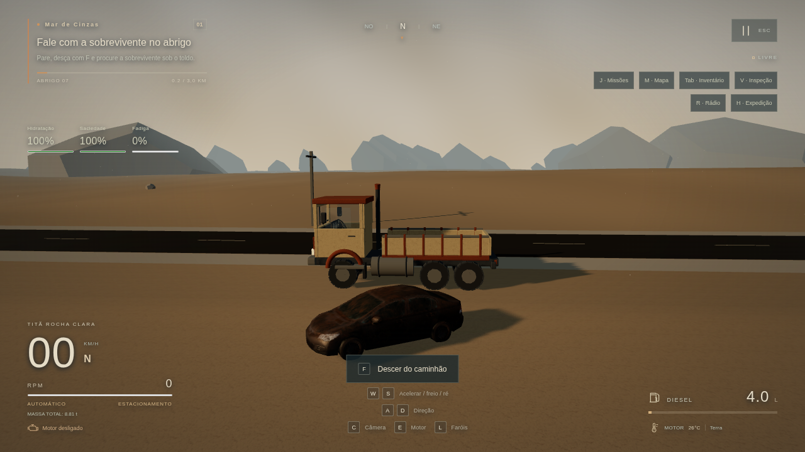

# Relatório completo para continuar no Claude — 2047: Rede Aurora

Data: 29/10/2026. Base verificada: **0.5.1**, commit **308f8df**, com implementação em **77e09c2**. Repositório **privado**: https://github.com/renataaap/2047. Branch: `main`. Tags: `v0.5.0`, `v0.5.1`, `reformulacao-fase-1`, `reformulacao-fase-2-parcial`; há tags históricas anteriores. Este documento transfere contexto, não transfere acesso a contas ou anexos desta conversa.

## Situação que o novo assistente precisa entender primeiro

O usuário quer continuar o projeto existente, agora com gráficos realistas de simulador de caminhões e sobrevivência. A direção low-poly/estilizada anterior foi substituída. Não começar outro jogo do zero. Não anunciar a reforma gráfica como concluída: **o exterior do Titã ainda é o anterior, os NPCs novos não estão integrados e há ZERO materiais Poly Haven instalados**. Três carros reais de cenário usam suas próprias texturas PBR.

Prioridade imediata: obter os mapas reais acessíveis, importar, aplicar no Mar de Cinzas, verificar visualmente e preservar a condução/saves. Depois preparar caminhões autorizados com física própria, NPCs, conteúdo e os finais. A auditoria abaixo identifica o que existe e o que falta.

## Acesso e execução em outro lugar

- O código e os três carros integrados estão no GitHub. No Claude Code, clonar o repositório autenticado na conta que tem acesso; no Claude Web, conectar o GitHub ou fornecer uma cópia do código. Um link privado sozinho não concede acesso e uma conversa nova não herda esta sessão.
- Workspace usado aqui: `/workspace/work/2047-rede-aurora`. Esse caminho é específico deste ambiente; localizar o checkout no computador novo.
- Node.js LTS 24 recomendado para ferramentas; usar `npm ci` e respeitar `package-lock.json`. Stack declarada: Next ^16.4.3, React ^19.3.1, Three ^0.186.1, Rapier ^0.21.0, libSQL ^0.18.0, JavaScript; Sharp 0.35.5 em devDependencies. Confirmar versões instaladas/documentação antes de usar APIs.
- Iniciar: `npm ci`, `npm run db:migrate`, `npm run dev`; abrir `http://localhost:3000` **no computador que executa o servidor**. No Windows, o iniciador existente é `INICIAR_JOGO.bat`.
- `localhost` não é uma hospedagem pública. Não houve deploy Vercel/Turso. O usuário anteriormente queria acessar o projeto/conversa pelo celular, não foram pedidos controles de toque.
- `.env*`, `local.db*`, dependências e artefatos de build estão ignorados no Git. Partidas locais e cookies de identificação não migram ao clonar o repositório. Preservar banco/configuração e perfil do navegador quando necessário; não publicar segredos/banco.

## Arquitetura e regras de continuidade

- Ler `AGENTS.md`, `STATUS_DO_PROJETO.md`, este relatório, `docs/REFORMULACAO_REALISTA.md` e `docs/PEDIDO_ASSETS_2026-10-29.md`. O `docs/PROMPT_MESTRE.md` é histórico e contém direção artística superada. Não reiniciar as fases antigas.
- React monta UI/canvas. `src/game/core/Game.js` coordena; `FixedLoop.js` mantém física 1/60 s. Não levar movimento por frame ao backend e não criar loops/listeners duplicados.
- Veículo: `src/data/truck-tuning.js`, `Engine.js`, `AutomaticTransmission.js`, `Powertrain.js`, `VehiclePhysics.js`. Atual: chassi 8.800 kg, Semente 2.200 kg, oito marchas, seis raycasts. GAZ/LP com quatro rodas precisam de adaptação real do controlador/layout e parâmetros próprios.
- Visual separado do corpo: `vehicle/model.js`, `Instruments.js`, `TruckVisual.js`. `render/Cameras.js`/`cameraCollision.js`, `input/Input.js`, `audio/EngineAudio.js`.
- Assets: `assets/AssetManager.js`, `render/PBRLibrary.js`, `TerrainBlend.js`, `metricUV.js`; mundo em `World.js`, `terrainGeometry.js`, `roadGeometry.js`, `EnvironmentModels.js`, `CampaignWorld.js`, `ExpeditionWorld.js`, `NetworkWorld.js`.
- Campanha/missões/regras em `game/missions`; inventário/sobrevivência em `game/survival`; dados em `src/data`; validação de saves em `game/persistence/schema.js`. Cinco biomas, sete Núcleos, cerca de 21 km de estrada e janela 3×3 de setores.
- Schema de save 3 aceita/migra versões 1/2. Preservar contratos API, slots, isolamento por cookie e restauração persistida. Não apagar partidas para facilitar testes.
- Novo jogo começa em N e motor desligado. E liga; W acelera/engata avanço; S freia e só engata R após parada segura. Espaço segura o caminhão; F sai/entra/interage. C câmera; L faróis; M mapa; R rádio; Tab inventário; V manutenção; H sobrevivência; J missões; Esc pausa.
- Preservar hotfix de saída F: busca de posição livre, botão de saída, parada segura e exploração em raio de 24 m fora de POIs. Não confundir E (ignição) com F (interação).
- Preservar personagens/lore, Semente e sete Núcleos. A Voz permanece misteriosa no jogo. Quatro finais não implementados. A ativação do sétimo Núcleo não significa que os finais existam.

## Arquivos enviados e onde estão

Anexos desta conversa **não acompanham automaticamente o GitHub nem chegam ao Claude**. Os arquivos preparados e incorporados ao jogo estão no repositório; os ZIPs brutos que não foram incorporados devem ser fornecidos novamente pelo usuário ao novo ambiente.

Foram enviados 20 ZIPs. A ferramenta daqui aceitou somente três: `prople_freepack_rigslgtf.zip`, `saia_ltl_freight_-_truck_half_trailer.zip` e `post-apoc_civilian_cars.zip`. Eles foram extraídos para uma área de trabalho externa ao checkout (`/workspace/work/asset-inputs`) neste ambiente. Essa pasta não faz parte do Git. Somente os três carros preparados foram publicados no repositório privado.

Os 17 arquivos abaixo foram recusados **antes de sua leitura**, por excederem 32 MiB por arquivo. Isso é limite da ferramenta deste ambiente, não uma propriedade das texturas, do Three.js ou necessariamente do Claude:

- container_side_4k.blend.zip
- rebar_reinforced_concrete_4k.blend.zip
- painted_metal_shutter_4k.blend.zip
- broken_brick_wall_4k.blend.zip
- asphalt_pit_lane_4k.blend.zip
- cracked_concrete_02_4k.blend.zip
- asphalt_02_4k.blend.zip
- rippled_sand_xd0mda1_4k_ue_high.zip
- sand_01_4k.blend.zip
- dump_truck_mercedes_benz_lp_608.zip
- leafy_grass_4k.blend.zip
- withered_grass_4k.blend.zip
- wood_peeling_paint_weathered_4k.blend.zip
- sparse_grass_4k.blend.zip
- brown_leather_4k.blend.zip
- worn_planks_4k.blend.zip
- garage_floor_4k.blend.zip

O kit `2047_texturas_faltantes_polyhaven_codex.zip` só tinha quatro arquivos textuais (catálogo/script/instruções), preservados em `docs/asset-kit`. Não tinha imagens. Não afirmar que esses materiais já estavam no projeto por causa dos nomes no catálogo.

## Continuação prática das texturas

Consultar `INSTRUCOES_TEXTURAS_PARA_CLAUDE.md` para comandos, formatos, preparação Windows e verificação. A rede deste ambiente retornou HTTP 403 para Poly Haven e o usuário não tem acesso à configuração. O Claude deve verificar o acesso no seu próprio ambiente, sem assumir que o bloqueio persiste e sem contornar restrições.

Os scripts de download/importação estão implementados, mas os IDs/existência/disponibilidade de mapas precisam ser confirmados pela API ou pelos arquivos reais. Importar não equivale a aplicar: revisar `MATERIAL_ROLES` e o uso dos materiais nas malhas. Vegetação/areia/restauração não estão todas mapeadas automaticamente. Validar a mistura com imagens reais, além do teste com fixtures.

## Verificação disponível

Últimas verificações da implementação: 87 unitários em 11 arquivos; 14 e2e completos; repetição final de cinco e2e relevantes; build Next passou. São resultados desta base, não promessa de que uma nova alteração passará sem testar. Evidências reais estão em `evidence/assets-integration`. Os testes com `fixture-validation-only` são sintéticos originais e não comprovam integração dos caminhões/NPCs/Poly Haven selecionados.

No aceite 1280×720/Médio com ANGLE SwiftShader (software): 42,88 km/h após W por oito segundos, 152 draw calls, 101.784 triângulos, cerca de 2,23 FPS, sem erros de console. Não houve validação de 60 FPS em GPU/Windows real. O teste longo usa teleporte de diagnóstico para encurtar trajetos; não é uma travessia humana contínua.

Comandos de verificação: `npm test`, `npm run build`, `npm run test:e2e`. Instalar Chromium com `npx playwright install chromium` quando necessário, ou selecionar um executável de sistema com `PLAYWRIGHT_CHROMIUM_EXECUTABLE`. Testes do navegador usam uma base local: preservar as partidas do usuário e conferir configuração antes de executar em outro computador.

## Relatório técnico da implementação

O conteúdo abaixo preserva o relatório entregue na 0.5.1. Caminhos relativos e evidências referem-se ao repositório.

# Integração parcial de assets — 0.5.1

29/10/2026 · projeto existente preservado · Fase 2 da reformulação **em andamento**.

## 1. Melhorias realizadas

- Três modelos reais de carros abandonados de Renafox convertidos para GLB, com UVs e materiais PBR próprios, texturas até 1K e escala em metros. Quatro posicionamentos escolhidos perto da rodovia, oficina e acesso ao Núcleo, com colisores orientados e streaming por proximidade.
- Terreno refinado junto à rede de estradas: amostras longitudinais de 8 m e faixas de aproximadamente 2 m nas rotas. Resolve a interpolação do terreno grosseiro sobre o asfalto. Mesma malha para visual e Rapier; setores 3×3 preservados.
- Segmentos de estrada reutilizáveis, UVs em metros e acostamentos com geometria/colisão e aderência de cascalho. Materiais do abrigo/oficina/cabine separados por função, preparados para receber mapas corretos.
- AssetManager local com cache, clones de esqueleto, referências e liberação de texturas, geometrias e esqueletos. Loader glTF/GLB e Meshopt oficial; ausência de um modelo não inutiliza o jogo.
- Downloader oficial revisado e importer offline, validação de imagens/checksums/cache, preparação de resoluções por perfil e manifesto que só publica materiais completos.
- PBRLibrary com sRGB/dados lineares, normal GL, ARM correto, UVs/escala física e troca de resolução por perfil. Mistura de solo/rocha/cascalho/rachaduras preparada por inclinação, altura e distância das estradas.
- Adaptadores separados para exterior/rodas do caminhão e animação de personagens. Testados com fixtures originais; **os caminhões/NPCs escolhidos não foram integrados**.
- IBL do céu procedural no Alto, mantida fora de Baixo/Médio após medir seu custo em renderização por software. Não se trata de HDRI baixado.

## 2. Arquivos modificados

| Grupo | Arquivos principais |
| --- | --- |
| Preparação | scripts/baixar-polyhaven.mjs, importar-polyhaven.mjs, inspecionar-glb.mjs, lib/polyhaven.mjs, lib/prepare-textures.mjs, prepare-cars.py, BAIXAR_TEXTURAS.bat |
| Catálogo/origens | materiais_2047.json, docs/CATALOGO_ASSETS.json, docs/asset-kit, docs/PEDIDO_ASSETS_2026-10-29.md |
| Recursos/renderização | src/game/assets/AssetManager.js, render/PBRLibrary.js, TerrainBlend.js, metricUV.js, materials.js, SceneRenderer.js |
| Mundo | world/EnvironmentModels.js, terrainGeometry.js, roadGeometry.js, World.js, CampaignWorld.js, ExpeditionWorld.js, terrain.js |
| Modelos/integração | vehicle/TruckVisual.js, model.js, player/CharacterActor.js, core/Game.js |
| Assets/registro | public/assets/models/manifest.json, environments/renafox-cars/*.glb e LICENSE.txt; polyhaven/manifest.json e instalacao.json |
| Testes | unit/asset-pipeline.test.js, road-geometry.test.js, e2e/assets.spec.js, helpers/asset-fixtures.mjs |
| Continuidade | README, STATUS, AGENTS, DECISOES, CHECKLIST_MANUAL, ASSETS_PENDENTES, COMO_ATUALIZAR, docs/INTEGRACAO_ASSETS.md |

Sharp 0.35.5 foi declarado explicitamente como dependência de preparação, na versão já trazida pelo Next. Não foi substituída a stack e não foi escrito código TypeScript. O build usa a verificação interna do Next.

## 3. Assets efetivamente instalados

| Asset | Origem | Formato | Estado | Uso |
| --- | --- | --- | --- | --- |
| Três carros abandonados | Renafox, pacote fornecido pelo usuário | GLB com PBR original até 1K | Integrados; 1.516 / 1.382 / 1.466 triângulos | Cenário com colisões e streaming |
| Poly Haven — 24 IDs | Catálogo do usuário/kit | PNG/JPEG esperados | **0 instalados** | API bloqueada; ZIPs 4K acima do limite |
| GAZ-52 selecionado | Sketchfab / Renafox | Não recebido | Não integrado | Termos/direitos e arquivo pendentes |
| LP 608 | Sketchfab / Max | ZIP recebido acima de 32 MiB | Não foi possível abrir | Modelo/rig/física pendentes |
| Peterbilt 359 | Sketchfab | Não recebido | Não integrado | Licença/arquivo e remoção das toras pendentes |
| Saia LTL Freight | Ehsan Abbasi; ZIP fornecido | glTF/BIN/imagens | Inspecionado, não integrado | CC BY-ND e 1.970.772 triângulos |
| City People | Denys Almaral; ZIP fornecido | 11 glTF rigados + BIN/PNG; 28 arquivos de animação | Inspecionado, não distribuído/integrado | Licença ausente no pacote e não localizada pelo usuário |
| Outros Fab | Seis páginas do pedido abertas | Texture set/glTF ou Unity/Unreal/PNG descritos | Não integrados | Arquivos/termos ou transferência pendentes |

A licença **CC BY-NC 4.0** dos carros foi preservada; origem e modificações constam no manifesto e nos créditos. Uso não comercial nesta versão de desenvolvimento. Código próprio não passou a ter licença NC; uma distribuição comercial precisaria substituir os assets ou obter direitos compatíveis.

Os arquivos de teste são originais e estão claramente identificados. Não contam como modelos selecionados, personagens Fab ou materiais Poly Haven instalados. Catálogo detalhado: [docs/INTEGRACAO_ASSETS.md](docs/INTEGRACAO_ASSETS.md).

## 4. Sistemas funcionais

Os carros reais carregam do diretório local, usam seus próprios materiais, colidem e são descarregados fora da proximidade. O teste confirma liberação do cache de modelos e recarga ao voltar. Novas estradas/terreno compartilham geometria visual/física; os acostamentos afetam a aderência.

Motor, torque/RPM, câmbio automático/ré segura, freios, suspensão, câmeras, instrumentos, saída F, exploração, recursos, manutenção, NPCs/diálogos anteriores, missões, sete Núcleos/restauração e API/saves permanecem operantes. O esquema de save não foi alterado.

A cadeia de PNG → material/shader e GLB → rodas/mixer funciona com fixtures originais no navegador. Nenhum arquivo de asset selecionado ausente foi considerado instalado por isso. A qualidade do terreno com os mapas reais e os caminhões de quatro rodas ainda não está validada.

## 5. Testes e resultados

- `npm test`: **87 testes / 11 arquivos passaram**. Incluem endpoints/seleção/MD5/SHA/tamanho, corrupção/cache, ausência de mapas, import offline 4K→2K sem alterar originais, resolução por perfil e preservação de canais ARM, contratos de rig/pivôs, caminhos locais, conexão de segmentos e correspondência de terreno/rodovia física.
- `npm run build`: passou, compilação final em **1,1 s**, dez rotas preservadas.
- Playwright completo: **14 testes passaram (5,2 min)**; log final em `evidence/assets-integration/e2e.log`.
- Novos testes de assets: sem Poly Haven instalado, nenhum acesso HTTP a terceiros, condução/saída; PNG/PBR/shader/GLB/mixer com fixtures; carros reais com PBR próprio, colisão física, descarregamento e recarga. A execução dirigida passou nos três cenários antes da suíte final.
- Aceite final de condução em 1280×720/Médio: **42,88 km/h após W por 8 s**, diesel de 4 para 3,9369 L; 152 draw calls, 101.784 triângulos, console sem erros. **2,23 FPS médios em ANGLE SwiftShader**, renderização por software. Não comprova desempenho/60 FPS em GPU real.

A primeira execução completa encontrou duas falhas: o teste novo pressionava E antes de a partida assíncrona terminar; e o custo do IBL em Médio reduzia o tempo físico avançado em SwiftShader. O teste passou a aguardar o contexto correto, e o IBL ficou restrito ao Alto. Outra verificação confundiu URLs `blob:` de imagens embutidas no GLB com HTTP externo; o filtro foi corrigido. Não foram reduzidos os critérios de velocidade/orçamento anteriores. O log da execução inicial foi preservado em `e2e-first-run.log`. Depois do ajuste final dos limites de acostamento, os cinco testes de assets/API/primeira entrega foram repetidos e passaram (`final-targeted-e2e.log`), além dos 87 unitários e do build.

## 6. Capturas reais

[Antes](evidence/assets-integration/before-start.png) · [depois, cenário atual](evidence/assets-integration/after-start.png) · [cabine preservada](evidence/assets-integration/after-cab.png). Todas são capturas do renderer do projeto. A captura `fixture-validation-only.png` é exclusivamente diagnóstico com modelos/texturas sintéticos originais, sem representar a qualidade final dos assets escolhidos.

Métricas e estados reais: local-assets-browser.json, real-models-browser.json, model-inspection.json e characters-inspection.json, em `evidence/assets-integration`.

## 7. Problemas encontrados

- A ferramenta recusou **17 dos 20 ZIPs por excederem 32 MiB**. Apenas personagens, Saia e carros puderam ser transferidos. Os arquivos recusados não foram abertos ou declarados instalados.
- Poly Haven segue bloqueado pelo proxy (HTTP 403). O usuário informou que não tem acesso à configuração; não houve tentativa de contornar a rede. A ferramenta de download registra a falha e preserva a instalação anterior válida.
- Licenças diferentes dos novos pacotes exigem usos distintos: carros NC usados no protótipo não comercial; Saia ND não adaptado; NPCs sem termos identificados permanecem fora da distribuição.
- O terreno de 21 m entre amostras interpolava encostas sobre o asfalto. O refinamento da faixa das rotas e os testes de raio corrigiram o trecho problemático.

## 8. Pendências e limites

- Não há materiais Poly Haven reais aplicados: receber arquivos menores/divididos ou executar o downloader no Windows.
- O caminhão continua com o exterior anterior. GAZ/LP/Peterbilt, remoção das toras, três físicas próprias e progressão de veículos não foram implementados.
- O adaptador verifica as seis rodas do chassi atual. Modelos com quatro rodas exigem mudança física própria, sem forçar um rig incompatível.
- Nenhum personagem City People foi adicionado ao Git/jogo. Há rigs/clips disponíveis, mas falta esclarecer a licença e preparar escala/retargeting. O pacote é estilizado e provisório para a proposta realista.
- Modelos finais de edifícios, heightmaps Fab, vegetação restaurada PBR, mistura completa de restauração/biomas, HDRI, ciclo solar e revisão final da iluminação seguem pendentes. Nenhum arquivo Unity/Unreal foi carregado como se fosse glTF.
- A mistura de terreno foi compilada com fixtures; escala, canais e aparência precisam de inspeção com os mapas reais. Height não é aplicado só no visual.
- Desempenho em GPU/Windows, conforto e sensação humana de condução continuam no checklist manual. Não houve deploy nem sincronização de saves entre aparelhos.

## 9. Próxima etapa técnica

Receber/reunir os ZIPs menores ou volumes de 25 MB, importar os mapas reais, revisar escala/canais e comparar a região com capturas reais. Depois, preparar um caminhão cuja licença permita a adaptação: medir rodas, eixos, chassi/cabine, ajustar massa/torque/câmbio próprios e verificar condução/câmeras/carga antes da progressão. Esclarecer a licença de City People antes de publicar os personagens; então combinar seus clips e substituir os visuais provisórios.

O projeto segue no GitHub `renataaap/2047`. No Windows: fechar o servidor antigo, atualizar o projeto, preservar banco/cookies e abrir `INICIAR_JOGO.bat`; conferir 0.5.1. Para os mapas: `BAIXAR_TEXTURAS.bat`. O arquivo [docs/INTEGRACAO_ASSETS.md](docs/INTEGRACAO_ASSETS.md) detalha o reenvio e a preparação offline.

A pedido do usuário, o roteiro completo também foi auditado: [AUDITORIA_FASES_2026-10-29.md](docs/AUDITORIA_FASES_2026-10-29.md). O jogo **não tem todas as fases concluídas**.

Checkpoint de código e assets: **77e09c2**. Documentação, auditoria e evidências estão no commit seguinte.

---

## Auditoria integral das fases do roteiro vigente

# Auditoria das fases — 29/10/2026

**Não, todas as fases ainda não terminaram.** Conferência do roteiro vigente de seis fases da reformulação realista, sobre a versão 0.5.1. Foram usados código, assets efetivamente presentes, relatórios, testes e capturas reais. Uma tela, um campo no save ou um loader preparado não contam como sistema/conteúdo completo.

Os relatórios 0.4.0 registram quatro fases de um roteiro anterior. Isso não encerra as seis fases do novo pedido. Também há sistemas funcionais de fases posteriores que já existiam antes da reforma gráfica; não foram refeitos nem apagados.

| Fase atual | Situação verificada | Funciona | Falta para encerrar conforme o pedido |
| --- | --- | --- | --- |
| 1 — Diagnóstico/condução | **Implementada e testada na 0.5.0; preservada** | Passo fixo; massa/carga física; diesel/torque/RPM; 8 marchas automáticas/N/R; freios; direção por velocidade; raycasts/suspensão; câmeras e instrumentos reais | Avaliação humana de peso/conforto, áudio e ajuste fino no Windows/GPU real. É uma simulação acessível, não uma réplica validada do ETS2 |
| 2 — Reformulação gráfica | **Parcial, não concluída** | Pipeline PBR/download/import offline; shaders/GLB/mixer testados com fixtures; terreno/estradas corrigidos; acostamentos físicos; 3 carros reais com PBR próprio, colisão/streaming; IBL procedural no Alto | Mapas Poly Haven reais (**0 instalados**); caminhão final detalhado; NPCs licenciados; materiais/escala conferidos com imagens reais; edifícios e ambientação; iluminação/clima final/ciclo solar. ZIPs menores/licenças necessários |
| 3 — Mar de Cinzas completo | **Base jogável, acabamento incompleto** | Abrigo inicial, oficina, desvio/atalho, bloqueio, recursos, pontos de interação, clima e primeira região percorrível; carros novos em locais escolhidos | Densidade e coerência ambiental no nível visual solicitado, modelos de construções, estradas/obstáculos/detalhes finais, inspeção humana da região. Não é apenas uma estrada vazia, mas ainda conserva arte procedural provisória |
| 4 — Survival/exploração | **Ciclo básico funcional e testado; refinamento pendente** | F para sair/entrar; andar/correr/olhar/colidir; inventário limitado e transferência; água/comida/fadiga; diesel; desgaste/danos/reparos; comércio, descanso, NPCs/interações básicas | NPCs novos animados/locomoção no mundo, expansão dos diálogos, ajustes de economia e travessia humana. Exploração livre fora de POIs fica limitada ao entorno de 24 m do Titã, como na base |
| 5 — Primeira entrega completa | **Vertical slice funcional e testada** | Receber Semente; preparar caminhão; escolher rota; transportar com dano de integridade; parar/desligar; interagir a pé; ativar Núcleo com consequência; chuva/plantas/abertura do bloqueio e save/load | Arte/encenação final, navegação mais completa e validação humana contínua sem teleportes. Entrega não é teleporte; o teste automatizado encurta trajetos com ferramenta de diagnóstico |
| 6 — Expansão/narrativa/finais | **Parcial; não concluída** | Cinco biomas e sete Núcleos/Cofres sequenciais; perigos/rotas próprias; três secundárias, trocas e rádio; restauração por região persistida; sete ancoragens verificadas | Narrativa completa, Brutus/Garcia e demais personagens desenvolvidos, decisões/finais conectados, quatro finais jogáveis, polimento das outras regiões. O sétimo Núcleo não é o final da história |

## Conferência transversal

- **Assets reais:** três GLBs de carros Renafox e seus mapas locais. CC BY-NC 4.0 limita seu uso à versão não comercial; licença/créditos/alterações preservados. Caminhões escolhidos e personagens Fab não estão incorporados. Não há nenhuma imagem Poly Haven local instalada.
- **Materiais preparados ≠ materiais aplicados:** shader PBR/normal GL/ARM e importação foram exercitados com fixtures originais. Isso prova o caminho técnico e não a aparência final com Poly Haven real.
- **Três caminhões/progressão:** não existe progressão GAZ → LP → Peterbilt funcional. O adaptador preserva a física atual e exige pivôs/escala compatíveis; quatro rodas e parâmetros próprios exigem trabalho medido a partir de um asset utilizável.
- **NPCs:** os visuais originais simples continuam. O pacote recebido contém 11 rigs e 28 arquivos de animação, mas não inclui licença identificável. O usuário não encontrou os termos. Não confundir o AnimationMixer de diagnóstico com personagens do pacote já inseridos no jogo.
- **Mapa:** há traçado real das vias, desvios, Núcleos/abrigos e escolha de leste/oeste. Falta um planejador geral de caminhos pela rede com comparação automática de distâncias, risco e custo. O mapa atual é uma representação recuperada de navegação, não um sistema completo de GPS.
- **Clima/restauração:** poeira, chuva e frentes/perigos/aderência/interferência locais funcionam. Restauração muda chuva, plantas, barreiras e condições de rota e persiste no save. Ciclo manhã/meio-dia/entardecer/noite e substituição visual completa de materiais por biome/restauração ainda faltam; não basta contar uma mudança de cor como toda a transformação pedida.
- **Áudio:** síntese Web Audio ligada a RPM/carga/trocas, impactos/ambiente/radio existentes. Gravações profissionais licenciadas de diesel e avaliação auditiva humana não estão concluídas.
- **Controles/câmeras:** teclado/mouse e três câmeras funcionam. Retrovisores refletivos, remapeamento completo, gamepad e câmbio manual não estão implementados; alguns são opcionais/condicionados à viabilidade no pedido.
- **Saves/API:** três slots, validação, cookies/isolamento, migração de saves 1/2/3, posição/carga/inventários/missões/restauração persistem na base local libSQL. O loop físico permanece no cliente. GitHub não sincroniza partidas; deploy/Turso remoto não foi feito.
- **Finais:** `finalChoice` é apenas um campo inicial/validável no save. Não há fluxo que implemente os quatro finais. Não foi revelado o segredo da Voz na UI. Texto antigo que dizia “chegam na Fase 5” foi corrigido para informar que ainda serão desenvolvidos.
- **Desempenho:** baixo/médio/alto, setores, instâncias/LOD/culling já existem; PBR tem resoluções por perfil e modelos novos são liberados por proximidade. Medição atual em software: 152 draw calls, 101.784 triângulos e 2,23 FPS em 1280×720/Médio. Não é validação de 60 FPS numa GPU. Windows/GPU real, memória medida em hardware e estabilidade longa permanecem pendentes.

## Evidências e limites da verificação

- **87 testes unitários / 11 arquivos passaram**: regras de sobrevivência, missões, save, veículos, motor/câmbio/freios/carga/pisos, tempo, câmera, PBR/checksums/importação e geometria/colisão.
- **14 testes completos do navegador passaram (5,2 min)**: partida/condução/saída, GLB/PBR de diagnóstico, modelos reais/colisão/streaming, câmeras/configurações, API/CRUD/isolamento, migração, primeira entrega/restauração, sobrevivência e jornada automatizada pelos sete Núcleos.
- **Repetição dirigida final: 5 testes passaram**, cobrindo os últimos ajustes dos acostamentos, assets, API e primeira entrega.
- **Build Next.js passou**, dez rotas. Logs em `evidence/assets-integration`.
- [Captura real dos carros no jogo](evidence/assets-integration/real-imported-wreck-close.png); [relatório da etapa](RELATORIO_INTEGRACAO_ASSETS.md); [catálogo/origens/impedimentos](docs/INTEGRACAO_ASSETS.md).

Passar nesses testes comprova os fluxos exercitados. Não comprova sozinho fotorealismo, dirigibilidade agradável, equilíbrio de uma viagem humana, conteúdo narrativo ausente ou autorização de uma licença que não veio no pacote.

## Ordem recomendada para fechar o projeto

1. Desbloquear os arquivos: mapas 1K/2K ou ZIPs em volumes de 25 MB, modelo de caminhão adaptável/licenciado e termos do pacote de NPCs. Integrar/medir os arquivos reais e finalizar a Fase 2.
2. Completar/polir o Mar de Cinzas, refinar exploração/economia e repetir uma entrega de ponta a ponta no Windows/GPU real.
3. Implementar a progressão dos três caminhões com configurações físicas próprias, animações/interações de NPCs e navegação pela rede.
4. Completar narrativa e decisões/finais, então polir as outras regiões e verificar persistência/progressão integral.
5. Só considerar o jogo terminado após cumprir os critérios visuais, funcionais, narrativos e de desempenho do pedido e avaliar a versão comercial/licenças, se esse for o destino escolhido pelo usuário.

Esta auditoria atende ao pedido de conferir as fases; não altera o estado das missões de uma partida e não marca funcionalidades pendentes como entregues.
