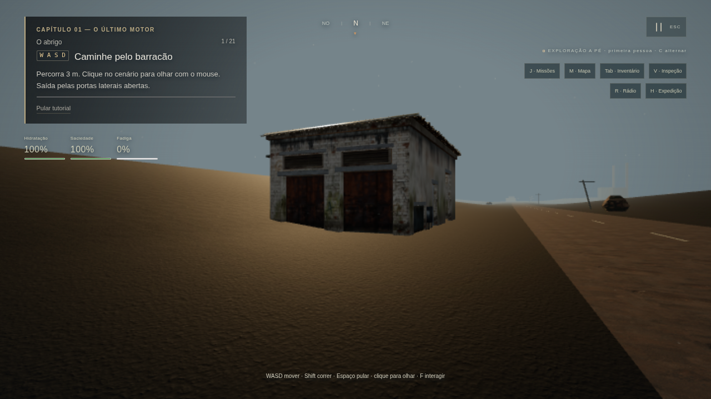
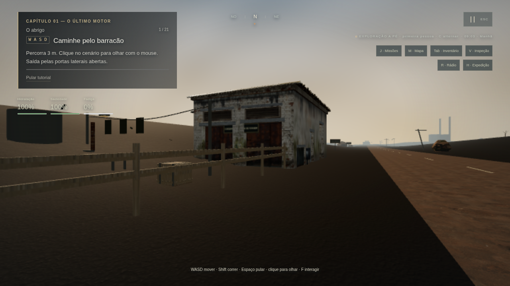
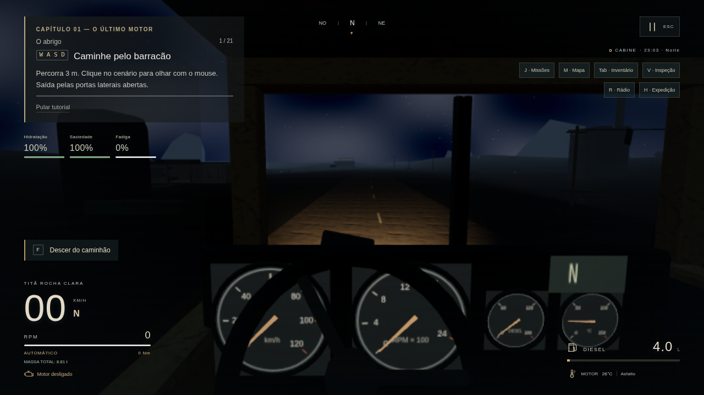

# Comparação visual — expansão 0.8.0

Capturas do WebGL do próprio projeto. A base 0.7.0 foi registrada antes das alterações, em 32d55b7. O script scripts/capturar-ambientes.mjs usa as mesmas posições, direção de câmera, viewport 1280×720, perfil Baixo e escala 75% para os pares abaixo. A iluminação da 0.8.0 inclui seu relógio solar; diferenças de luz são parte da mudança. Não foram usadas imagens promocionais ou renderizações externas.

| Local | Base 0.7.0 | Expansão 0.8.0 |
| --- | --- | --- |
| Barracão | [Antes](../evidence/world-0.8.0/before/barracao.png) | [Depois](../evidence/world-0.8.0/after/barracao.png) |
| Arredores | [Antes](../evidence/world-0.8.0/before/arredores.png) | [Depois](../evidence/world-0.8.0/after/arredores.png) |
| Estrada inicial | [Antes](../evidence/world-0.8.0/before/estrada.png) | [Depois](../evidence/world-0.8.0/after/estrada.png) |
| Oficina do Cotovelo | [Antes](../evidence/world-0.8.0/before/oficina.png) | [Depois](../evidence/world-0.8.0/after/oficina.png) |
| Posto Boa Viagem | [Antes](../evidence/world-0.8.0/before/posto.png) | [Depois](../evidence/world-0.8.0/after/posto.png) |

As cinco vistas finais foram executadas e inspecionadas. Os arquivos capture.json registram posições, modelos, erros e contagens por captura. As imagens de incrementos são anteriores ao polimento final. As poses dos cinco pares coincidem; não foram substituídas por enquadramentos mais favoráveis.

O barracão recebeu quadro de ferramentas, sinais de armazenamento e área doméstica; os arredores mostram cercas, varal, reservatório e cozinha. A estrada recebeu composições coerentes, cabos e sinalização, além de dano físico. Oficina e posto têm ferramentas, equipamento e áreas de manutenção/estoque. Fachadas e mobiliário modulares ainda precisam de acabamento artístico; as imagens não demonstram arte final fotorealista.

## Arredores: par comparável

Antes:

Depois:

## Vistas adicionais

Estas vistas não têm par histórico: mostram o conteúdo por outro ângulo, sem substituir as cinco comparações acima.

- [Área de moradia: cama e prateleiras](../evidence/world-0.8.0/moradia/moradia.png)
- [Ferramentas na oficina](../evidence/world-0.8.0/detalhes/oficina-detalhe.png)
- [Bancada externa e estoque do posto](../evidence/world-0.8.0/detalhes/posto-detalhe.png)
- [Motel acessível](../evidence/world-0.8.0/pois/motel-exterior.png)
- [Pátio com caminhão estático](../evidence/world-0.8.0/pois/yard-exterior.png)
- [Balança e acesso lateral](../evidence/world-0.8.0/pois/weighbridge-exterior.png)
- [Cabine à noite, faróis desligados](../evidence/world-0.8.0/night/estrada-sem-farois.png)
- [Cabine à noite, faróis ligados](../evidence/world-0.8.0/night/estrada.png)

O procedimento de inspeção encontrou placas sem fixação, letreiro traseiro invertido/oculto e iluminação insuficiente dos faróis. Essas questões foram corrigidas e as vistas afetadas refeitas. O piso e a menor cota do GLB parado também foram conferidos; o diagnóstico registra diferença de cota próxima de zero. As imagens anteriores desses ajustes estão em visual-before-fixes, distintas da base histórica 0.7.0.

## Noite com os faróis ligados

O renderizador deste ambiente é Chromium/SwiftShader em Linux, por software. Esta comparação verifica conteúdo e iluminação em jogo; não aprova FPS, áudio nem execução Windows/GPU real.
